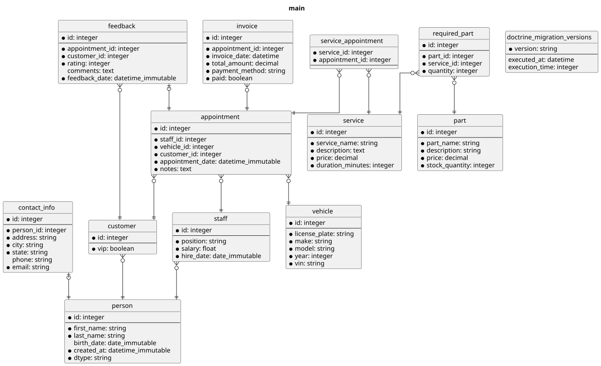
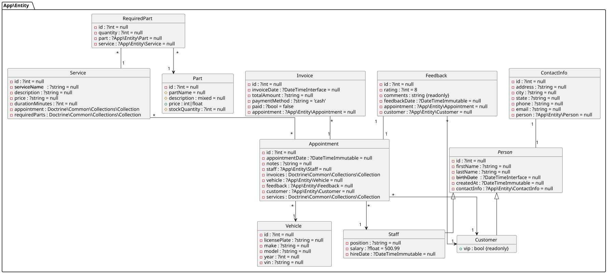

# 📐 Doctrine Diagram Bundle

**Generate Entity-Relationship and UML class diagrams from a Symfony
application's Doctrine schema.**

[](https://packagist.org/packages/jawira/doctrine-diagram-bundle)
[](https://packagist.org/packages/jawira/doctrine-diagram-bundle)
[](https://packagist.org/packages/jawira/doctrine-diagram-bundle)
[](https://packagist.org/packages/jawira/doctrine-diagram-bundle)

Use the bundle to inspect the current database schema and Doctrine entities. It
generates diagrams for monitoring and visualization.

## Features

* Generate ER diagrams from a Doctrine DBAL connection and class diagrams from
  Doctrine entities.
* Choose `mini`, `midi`, or `maxi` detail.
* Export PlantUML source (`puml`) or render diagrams as `svg` and `png`.
* Apply built-in PlantUML themes and filter tables or classes with include and
  exclude patterns.
* Render locally with PlantUML or through a PlantUML server.

## Installation

With Symfony Flex, enable community recipes (once per project) and require the
bundle as a development dependency:

```console
composer config extra.symfony.allow-contrib true
composer require jawira/doctrine-diagram-bundle --dev
```

## Documentation

Read the documentation: <https://jawira.github.io/doctrine-diagram-bundle/>.

## Generate diagrams

```console
# Entity-Relationship diagram
bin/console doctrine:diagram:er

# UML class diagram
bin/console doctrine:diagram:class
```

By default, the commands write `er.svg` and `class.svg` to the project root.
The default format is SVG. Use `--format=puml` to write PlantUML source without
requiring a renderer, or `--format=png` for a PNG image.





* See the [Generating diagrams][usage] guide for connections, entity managers,
  and output options.
* For themes, filters, and configuration,
  see [Configure the bundle][configuration].

[usage]: https://jawira.github.io/doctrine-diagram-bundle/usage.html
[configuration]: https://jawira.github.io/doctrine-diagram-bundle/configuration.html

## Contributing

* Please [report bugs and request features][issues].
* If useful, ⭐ [star this bundle on GitHub][repo].

[issues]: https://github.com/jawira/doctrine-diagram-bundle/issues
[repo]: https://github.com/jawira/doctrine-diagram-bundle

## License

This library is licensed under the [MIT license](LICENSE.md).

***

## Packages from jawira

<dl>

<dt>
  <a href="https://packagist.org/packages/jawira/plantuml">jawira/plantuml
  </a>
</dt>
<dd>Provides PlantUML executable and plantuml.jar</dd>

<dt><a href="https://packagist.org/packages/jawira/">more...</a></dt>
</dl>
